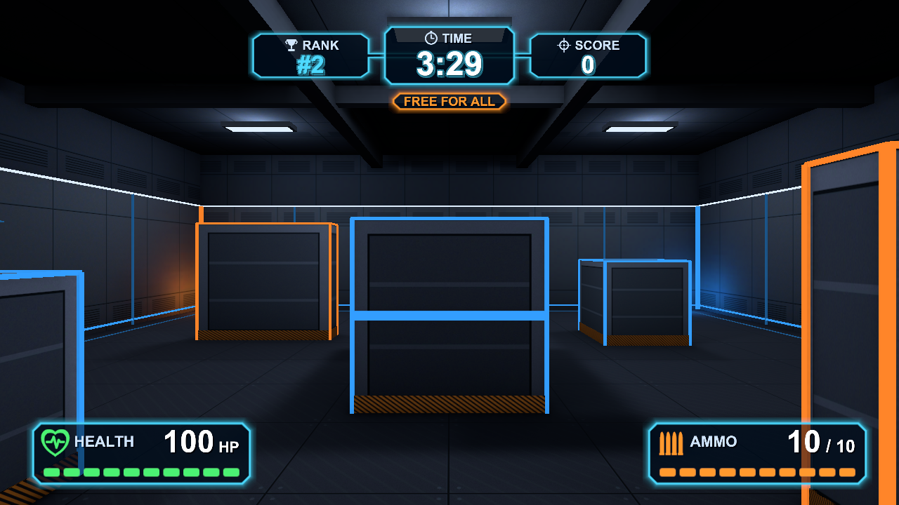

# Multiplayer VR Laser Tag

**A shared virtual arena for Meta Quest 2 and Quest 3.**

CMPS297AG - Introduction to XR | Six-member team approved by the professor

Take cover, teleport between positions and compete in a timed free-for-all match. Each player uses a separate clear physical area while seeing the same virtual arena and other players' tracked avatars.



*Unity camera-rendered Windows layout preview. This image is not a Quest headset capture; preview values are illustrative.*

## Start here

| Goal | Guide |
| --- | --- |
| Install the APK and join a match | [Setup, installation and controls](docs/SETUP.md) |
| Understand authority and synchronization | [Architecture](docs/ARCHITECTURE.md) |
| Review what has actually been tested | [Testing and evidence](docs/TESTING.md) |
| Check assignment coverage and remaining work | [Requirements and submission checklist](docs/SUBMISSION-CHECKLIST.md) |
| Read the technical report and contributions | [Combined report](docs/Technical-Report-and-Contributions.pdf) |
| Review sources, licenses and AI assistance | [Credits and provenance](docs/CREDITS.md) |
| Rehearse the live demonstration | [Demonstration plan](docs/DEMO.md) |

## Gameplay

- Up to five connected players; a match can start with two.
- Tracked head, hands and avatar body in one shared virtual coordinate system.
- Teleport locomotion with destination and occupancy checks.
- Server-authoritative hits, damage, ammunition, reloads, scores and match state.
- 100 HP, 25 damage per accepted hit, 10-shot magazine and two-second reload.
- Five-minute free-for-all, three-second respawn, winner/tie and restart flow.
- World-space menus and independently configured Windows, Quest 2 and Quest 3 HUD layouts.

## Verification status - 15 November 2026

**The team reports a successful latest-APK test with three simultaneous players on Quest 2 and Quest 3, including the updated HUD.** Earlier mixed-device tests took place on 13 and 14 November. Detailed hardware logs and headset captures were not supplied for the latest retest.

Historical desktop tests cover three- and five-process matches. Desktop process counts are separate from physical-headset coverage. Five simultaneous headsets and measured Quest 2 frame times remain outstanding. See [evidence and limitations](docs/TESTING.md).

## Build identity

| Item | Value |
| --- | --- |
| Submission branch | `feature/headset-fixes` |
| Reviewed source commit | `0104d280a7061ee4d521df5025a6f44631f2b3d7` |
| Unity | `6000.6.2f1` |
| Unity project folder | `VRLaserTag/` |
| Main scene | `Assets/ArenaScene.unity` |
| APK | `VRLaserTag-Quest-HUD.apk`, version `0.1.0` / code `1` |
| Android build | IL2CPP, ARM64; min API 32, target API 36 |

Obtain the APK from the accompanying submission ZIP. It is excluded from source control. Source access and an installable APK are both supplied for assessment; the private repository requires reviewer access. The APK SHA-256 and source-to-build limitations are recorded in the [setup guide](docs/SETUP.md).

## Team

| Member | Confirmed responsibility |
| --- | --- |
| Mostafa Bdeir | HUD and VR interface |
| Ali Jomaa | Combat and weapons |
| Rami Bawadi | Movement collision and respawning |
| Lena Madi | Networking and avatar synchronization |
| Alaa Mansour | Match rules and arena integration |
| Sally Sinno | Quest deployment and verification |

The team confirmed these allocations. They describe shared implementation, integration, review and explanation responsibilities; they do not imply exclusive file authorship. Full details appear in the [contribution statement](docs/CONTRIBUTIONS.md).

## Repository layout

```text
VRLaserTag/
  Assets/             Arena scene, prefabs, scripts, XR configuration and artwork
  Packages/           Package manifest and lockfile
  ProjectSettings/    Unity project configuration
docs/                 Setup, architecture, testing, credits and submission report
README.md             Project entry point
```

The project is fully virtual. Keep Quest boundaries enabled and use separate clear play areas. Virtual collision handling cannot physically stop a player.

`VRLaserTag/CHANGES.md` is a historical implementation record; this README and the dated test record explain current validation status. No repository-wide open-source license has been selected. Third-party terms and retained notices are listed in [Credits](docs/CREDITS.md).
