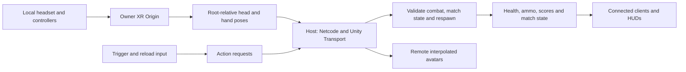

# Architecture and engineering decisions

## Authority and data flow

The host decides hits, damage, ammunition, reloads, elimination, respawning, scores, timing and results. Clients provide their own tracking poses and request actions. This gives every client one authoritative outcome without requiring a separate dedicated server. The tradeoff is dependence on the host: leaving ends the session and server-arrival ordering affects simultaneous actions.

Local trigger feedback is immediate. An accepted hit or scored elimination depends on server validation. Predicted visual/audio effects therefore do not by themselves prove damage was accepted.

## Shared virtual coordinates

Each device loads the same ArenaScene. SpawnManager assigns predefined locations. NetworkVRPlayer associates the owning network avatar with the local XR Origin, sends root-relative head/hand poses at approximately 20 Hz and interpolates remote poses. Large changes are treated as teleports. Network-root and XR-Origin movement are coordinated during spawning and respawning.

This keeps tracked local motion distinct from the network representation. Interpolation smooths updates between pose messages, with a bandwidth/latency tradeoff. No measured bandwidth budget is claimed. Shared physical anchors are unnecessary because players occupy separate physical areas; they share virtual coordinates.

## Shot validation and recovery

1. The client checks its current synchronized state and requests a shot.
2. The host checks ownership, match state, fire interval, elimination, reload, ammo and origin validity.
3. Muzzle overlap and head-to-muzzle obstruction checks reject reaching a gun through cover.
4. Distance-sorted ray hits stop at the first valid obstacle or target, skipping the shooter and eliminated targets.
5. The host updates health and, on elimination, awards a point once and schedules a respawn.
6. Health/ammo reset at respawn, with temporary spawn protection. The host moves the network avatar and the owner's local rig.

Hit detection uses the host's latest received poses. No lag compensation is implemented. Simultaneous requests resolve in arrival order; the game does not guarantee trades or latency-independent fairness.

## Teleportation and physical safety

Teleportation is the primary virtual locomotion method. Destination checks reject blocked, occupied or out-of-arena locations and respect match/elimination restrictions. Local head collision handling uses push-back and a fade fallback. This can limit virtual wall penetration but cannot constrain a person's real body. Boundary systems stay enabled; the game uses no passthrough or room reconstruction.

## HUD

PlayerHUD reads live synchronized health, ammo, rank, score and timer. It builds a world-space Canvas with a connected top group and lower side panels. Windows, Quest 2 and Quest 3 have separate size/placement profiles. ComfortHud compensates for parent scale and distance changes; panel fitting accounts for full bounds rather than centres alone.

The HUD work retained the existing element count, cached live-value updates and rendering approach. Two cached nine-sliced tab textures use approximately 640 KiB. No measured Quest frame-time improvement is claimed.

## Main implementation files

| System | Files under `VRLaserTag/Assets/Scripts/` |
| --- | --- |
| LAN session and tracking | LanConnectionManager.cs, NetworkVRPlayer.cs |
| Combat | PlayerCombat.cs, LaserGunShooting.cs |
| Match and identity | MatchManager.cs, PlayerInfo.cs |
| Spawn and movement | SpawnManager.cs, ValidatedTeleportationArea.cs, HeadCollisionFade.cs |
| Interface | PlayerHUD.cs, ComfortHud.cs, HudArt.cs, VRMenuUI.cs, ScoreboardUI.cs |

Detailed implementation and remaining limitations appear in the [technical report](Multiplayer-VR-Laser-Tag-Technical-Report.pdf).
