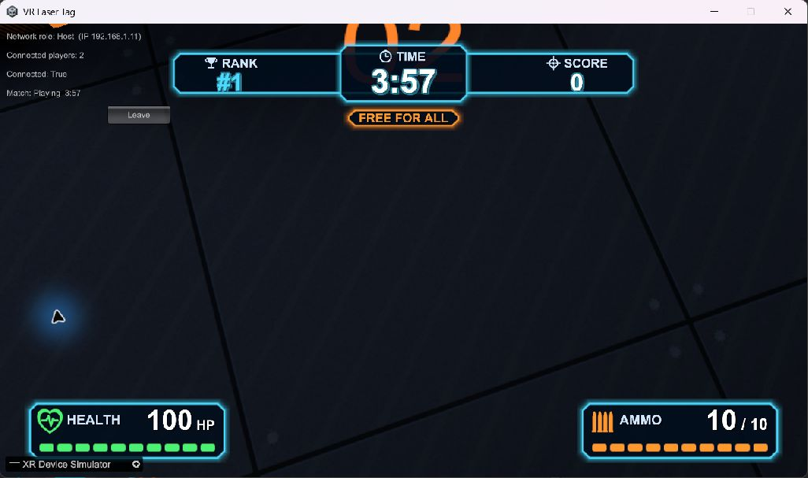
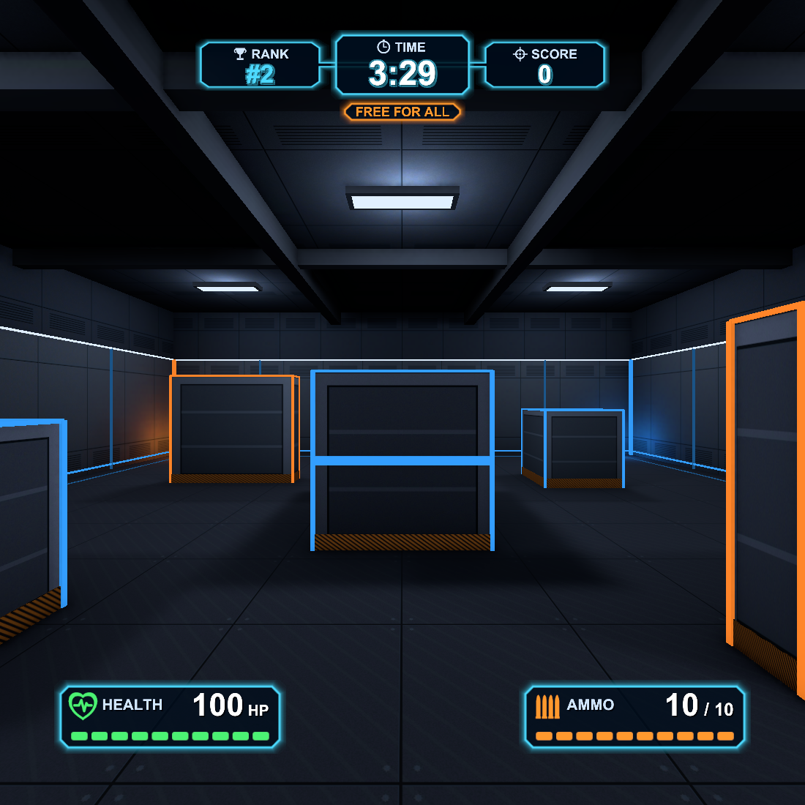
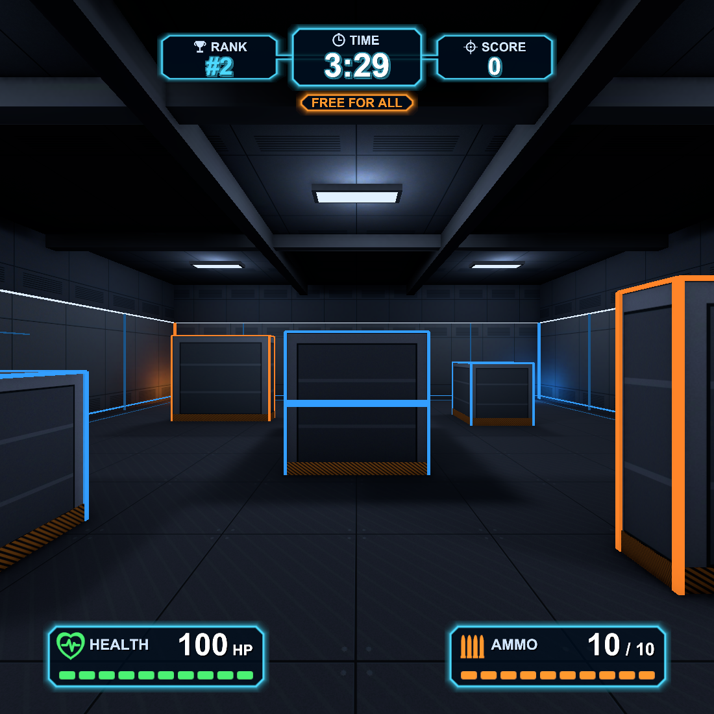

# Testing and evidence

Record updated 15 November 2026. Test provenance is part of each result. Team-reported success is retained without inventing logs, measurements or individual observations.

| Record | Platform and scope | Result | Evidence limit |
| --- | --- | --- | --- |
| H-01 | Quest 2 and Quest 3, three players, 13-14 November | Earlier collision, HUD and teleport issues were reported resolved on 14 November | Team account; exact earlier APK identities and per-feature logs not supplied |
| H-02 | Latest APK including updated HUD; Quest 2 and Quest 3, three simultaneous players, 15 November | Team confirmed everything worked | Team report; no detailed per-feature logs, headset software versions, model counts or captures supplied |
| D-01 | Historical desktop three/five-process stay and leave scenarios | Local summaries reported PASS and matching final states | Desktop processes are not five headsets; historical tests do not prove every current hardware case |
| D-02 | Windows standalone plus Editor client, updated HUD | Health, ammo, rank, score and time bindings matched synchronized values | [Recorded values](evidence/live-values.txt); not a headset performance test |
| P-01 | Windows and representative Quest 2/3 camera projections | Panel bounds and near-cover apparent sizing checks passed | [Bounds record](evidence/layout-audit.txt); Quest images are simulated projections |
| A-01 | Delivered APK signature, manifest and archive checks | Signature, ARM64 libraries and Quest 2/3 declarations verified | [Verification record](evidence/apk-verification.json); static verification is separate from runtime testing |
| D-03 | Fresh automated desktop rerun | Inconclusive: PlayerPrefs access failed before clients connected | Environment-blocked; not counted as gameplay PASS |

H-02 refers to the delivered APK `VRLaserTag-Quest-HUD.apk`; SHA-256: `72c6c41d48030c1920e917b7661d17e7ec46e8c95f9b8ded5d2e77250e470ebc`. The team confirmed it was the latest delivered APK; no separate on-device checksum was supplied.

## Images

*Actual rebuilt Windows game, two connected players. The simulator camera faces the floor in this capture; it demonstrates the HUD in a standalone player, not Quest rendering.*

| Quest 2 profile | Quest 3 profile |
| --- | --- |
|  |  |

*Unity camera renders with illustrative values and representative headset projections. Neither image is a physical-headset capture.*

## Remaining verification

- Five simultaneous physical headsets, including Quest 2 and Quest 3.
- Quest 2 CPU/GPU frame times, configured refresh rate and dropped frames during representative multiplayer load. The brief sets no numerical FPS threshold.
- Explicit final-build records for simultaneous firing, client loss, host loss, occupied/invalid teleport destinations, gun-through-cover attempts, respawn and winner/tie/restart.
- Venue-network rehearsal and a clean-source build comparison.

General three-player success does not establish all of these separate scenarios. For each remaining case, record date, exact build, model counts/software versions, procedure, expected result, actual result and an evidence filename. Keep failures visible until retested.
